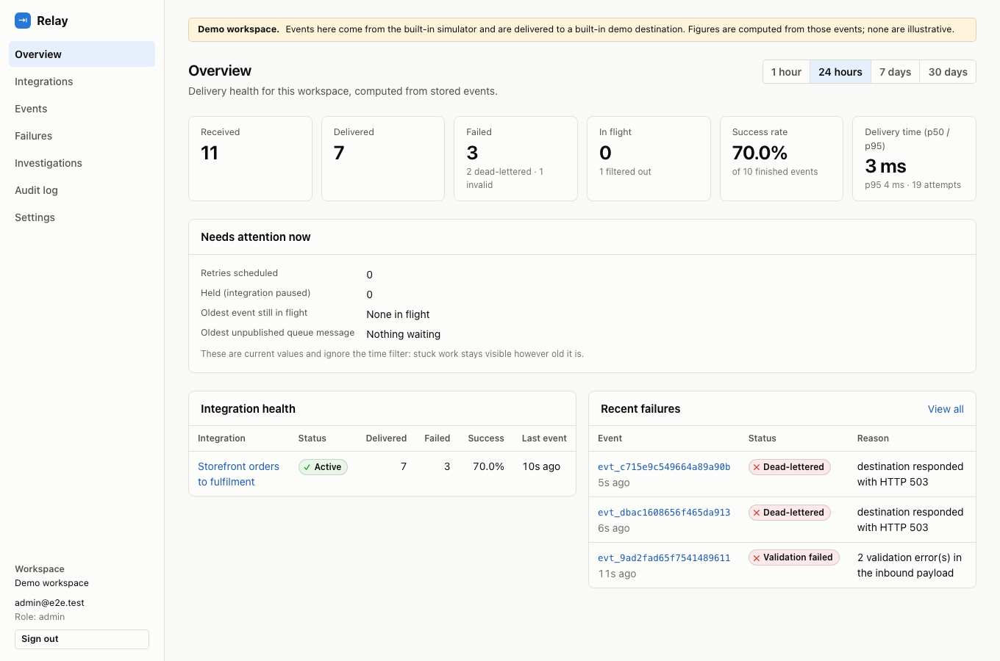
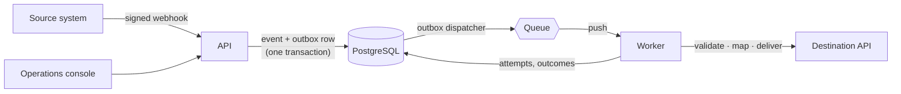
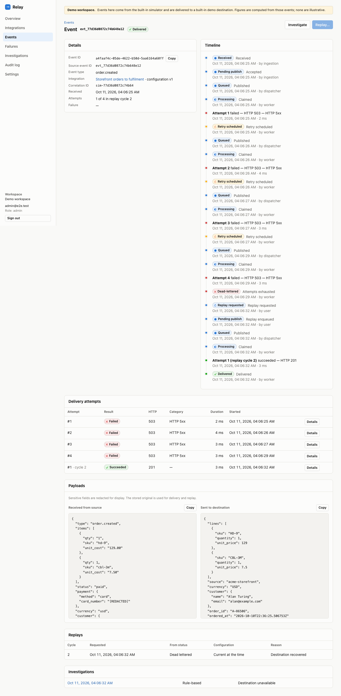
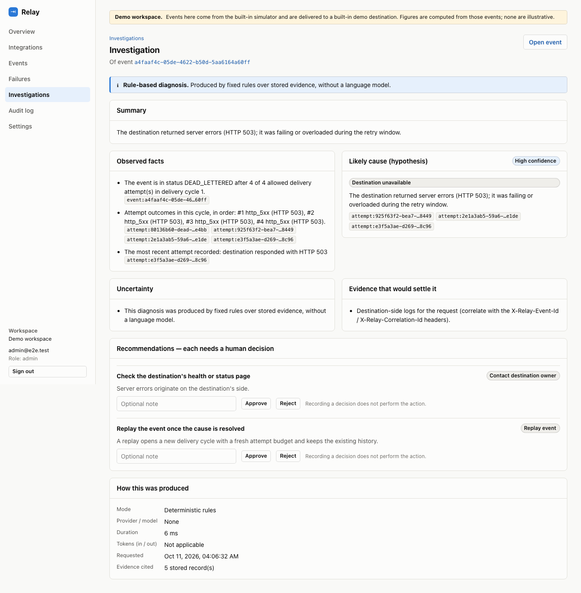

# Relay

**An event-driven integration and reliability platform.** Relay receives events from one system,
validates and reshapes them, and delivers them to another system's API — and keeps doing the right
thing when that API is slow, down, throttling or rejecting.

Connecting two systems is easy to do badly: a crash between "saved" and "queued" loses an event, a
retry storm takes a struggling API down, a lost response creates a duplicate order. Relay is a small,
complete implementation of the parts that make that dependable: durable ingestion, a transactional
outbox, bounded retries, dead-lettering, audited replay, and the tooling to see what happened.



> A portfolio project. It has no customers and has not been deployed; see
> [Status](#status-what-is-and-is-not-verified) for exactly what has and has not been verified.

## What it does



1. A source posts a JSON webhook. Relay verifies its HMAC signature, stores the event and an
   outbox row **in one transaction**, and answers `202`.
2. A worker validates the payload, applies a declarative field mapping, validates the result, and
   calls the destination.
3. On failure it classifies the outcome. Retryable ones are retried with exponential backoff and
   jitter; permanent or exhausted ones are **dead-lettered** with a visible reason.
4. An operator can inspect the full history, ask for a read-only diagnosis, and **replay** the event
   — an audited action that keeps every earlier attempt.

## Try it in five minutes

Needs [uv](https://docs.astral.sh/uv/), Node 22+ and PostgreSQL 15+ binaries on your `PATH`
(`brew install postgresql@16` on macOS). No Docker, no cloud account, no API keys.

```bash
make setup     # dependencies, .env with generated secrets, a project-local Postgres, schema, demo data
make dev       # API :8000 · worker :8001 · UI http://localhost:5173
```

Sign in as `operator@relay.local`; its password is `RELAY_SEED_OPERATOR_PASSWORD` in the generated
`.env`. Then follow the [demo walkthrough](docs/demo-walkthrough.md): a successful delivery,
automatic retry, dead-letter → investigate → replay, a lost response that does *not* create a
duplicate, and a viewer being refused by the API.

| A dead-lettered event, replayed | Investigating a failure |
|---|---|
|  |  |

## Engineering highlights

| Problem | How Relay handles it | Where |
|---|---|---|
| A crash between "commit" and "publish" loses the event | **Transactional outbox** with leased claims (`FOR UPDATE SKIP LOCKED`); a row is marked published only after the broker confirms | [`services/outbox.py`](packages/relay_core/relay_core/services/outbox.py) |
| The same event arrives twice, possibly at once | Unique constraint on a hashed event identity; `INSERT … ON CONFLICT DO NOTHING` | [`services/ingestion.py`](packages/relay_core/relay_core/services/ingestion.py) |
| Status changes drift into impossible states | One **state machine** table; one function may change status; a static test enforces it | [`domain/states.py`](packages/relay_core/relay_core/domain/states.py) |
| A worker dies mid-delivery | **Leases**: the attempt is closed as interrupted and retried; interrupted attempts consume the budget so a crash loop ends | [`services/processing.py`](packages/relay_core/relay_core/services/processing.py) |
| Retries multiply (broker × application) | The worker acknowledges every outcome it has persisted, so the two mechanisms never stack | [reliability.md](docs/architecture/reliability.md) |
| Reshaping payloads without running user code | A **bounded declarative DSL**: paths, typed conversions, defaults, `each`; no `eval`, no expressions | [`domain/transform/`](packages/relay_core/relay_core/domain/transform/) |
| An operator-supplied URL could target internal services (SSRF) | Resolve, require every address public, **connect to the pinned address**, never follow redirects | [`domain/urlsafety.py`](packages/relay_core/relay_core/domain/urlsafety.py) |
| A rate limit that resets on every cold start limits nothing | Fixed-window counters in the database, shared by all instances | [`services/ratelimit.py`](packages/relay_core/relay_core/services/ratelimit.py) |
| An assistant reading attacker-controlled text | Read-only tools in a `READ ONLY` transaction; output validated; evidence references checked; approval executes nothing | [`ai/`](packages/relay_core/relay_core/ai/) |

**The guarantee, stated honestly:** *at-least-once delivery with deduplication and idempotency
protections.* If a destination's response is lost, Relay must retry and the destination may see the
event twice; every request carries a stable idempotency key so a destination that honours it applies
it once. Relay does not claim exactly-once side effects. The demo's "slow success" mode shows this
case end to end.

## Stack

| | |
|---|---|
| Backend | Python 3.12, FastAPI, Pydantic, SQLAlchemy 2, Alembic, PostgreSQL 16 |
| Frontend | React 19, TypeScript (strict), Vite, TanStack Query |
| Messaging | Google Cloud Pub/Sub (cloud) · PostgreSQL-backed queue (local) |
| Infrastructure | Terraform: Cloud Run, Pub/Sub, Scheduler, Secret Manager, Artifact Registry, Workload Identity Federation |
| CI/CD | GitHub Actions: lint, strict types, tests, coverage floor, browser e2e, audits, SBOM, image builds; digest-based promotion |
| Assistant (optional) | Read-only MCP tools; Ollama, OpenAI-compatible or Anthropic; deterministic fallback |

## Tests

```bash
make check          # lint, strict types, 632 Python tests with coverage, web tests, build
make test-web-e2e   # browser tests against a throwaway stack
```

| Suite | Tests | Proves |
|---|---|---|
| Unit | 295 | Transformation DSL, state machine (all 121 state pairs), retry maths, property-based checks |
| Integration | 110 | Ingest → deliver through both services on real PostgreSQL; retries, replay, outbox and lease recovery |
| Security | 173 | SSRF rules, signatures, the role matrix, workspace isolation, the assistant's boundaries |
| Contract | 47 | Pub/Sub envelope, every adapter, three model-provider wire formats, the MCP server |
| End to end | 7 | Two real servers, queue and demo destination over real sockets |
| Web unit · browser | 30 · 7 | UI states, permission gating, accessibility; the main journeys in Chromium |

Core logic coverage is 90% (floor: 80%). Counts are from a local run on 2026-10-11. The same
suites also passed on Linux in the first GitHub Actions run that day. Details and the
acceptance-criteria mapping:
[testing-strategy.md](docs/quality/testing-strategy.md).

## Repository layout

```text
apps/web/                 React console (+ Cloudflare Pages proxy functions)
services/api/             FastAPI control plane and webhook edge
services/worker/          FastAPI push receiver, outbox dispatcher, lease reaper
packages/relay_core/      Domain, persistence, adapters, application services, investigation, MCP server
tests/                    unit · integration · contract · security · e2e
evals/                    Investigation scenarios and scoring
infra/gcp/                Terraform (validated; never applied from here)
scripts/                  Local Postgres, setup, seed, simulator, smoke test
docs/                     PRD, architecture, ADRs, API, UI, testing, cost model, runbook
.claude/                  Scoped engineering rules for AI-assisted work
```

## Documentation

| | |
|---|---|
| [Product requirements](docs/PRD.md) | Problem, users, requirements, acceptance criteria, non-goals |
| [Architecture overview](docs/architecture/overview.md) | Components, layers, the life of an event |
| [Reliability](docs/architecture/reliability.md) | State machine, transaction boundaries, every failure mode |
| [Data model](docs/architecture/data-model.md) · [Algorithms](docs/architecture/algorithms.md) | Tables and indexes · mechanisms and their trade-offs |
| [Security](docs/architecture/security.md) | Threat model with the test that verifies each mitigation |
| [Decisions](docs/architecture/decisions/) | Six ADRs |
| [API contracts](docs/design/api-contracts.md) · [OpenAPI](docs/design/openapi.json) | Conventions and the machine-readable contract |
| [UI/UX](docs/design/ui-ux.md) | Screens, visual system, accessibility |
| [Cost model](docs/deployment/free-tier-cost-model.md) · [Runbook](docs/deployment/runbook.md) | Verified free-tier arithmetic · deploy, rollback, teardown |
| [Project state](docs/PROJECT_STATE.md) | What exists, what is verified, what is next |

## Status: what is and is not verified

**Verified on a local machine (2026-10-11):** every test suite above; the full pipeline running as
real processes; TLS delivery with address pinning against a public host (valid certificate accepted,
mismatched certificate refused); Terraform with `terraform validate`; workflows with `actionlint`;
the smoke test against a local API.

**Verified in CI (first GitHub Actions run, 2026-10-11, Ubuntu):** Python lint, strict types,
migrations, tests and coverage floor; web lint, types, tests and build; browser end-to-end; both
dependency audits; Terraform validation; and a build of both container images. That run's secret
scan failed on three synthetic test fixtures that resembled real key formats — no real credential
was committed — and the fix is described in [project state](docs/PROJECT_STATE.md).

**Not verified:**

- **Nothing has been deployed.** No cloud resource exists. Pub/Sub, Cloud Run, Scheduler, Secret
  Manager, Workload Identity Federation and the Cloudflare proxy have never run this code. The
  deploy jobs have only ever been skipped.
- **Container images build but have never been run**, and `docker-compose.yml` has not been
  exercised.
- **No live model** has been used. The assistant was tested against scripted model responses; the
  rule-based diagnosis is what actually ran.
- **No performance, scale or cost measurements** exist, and none are claimed. The cost model is
  arithmetic from published allowances.

The cloud design targets $0/month at demo volume on standing free tiers. That is a target, not a
guarantee: a billing account is required, allowances change, and a budget alert does not cap
spending.

## License

No license has been chosen yet; until one is added, all rights are reserved by the author.
