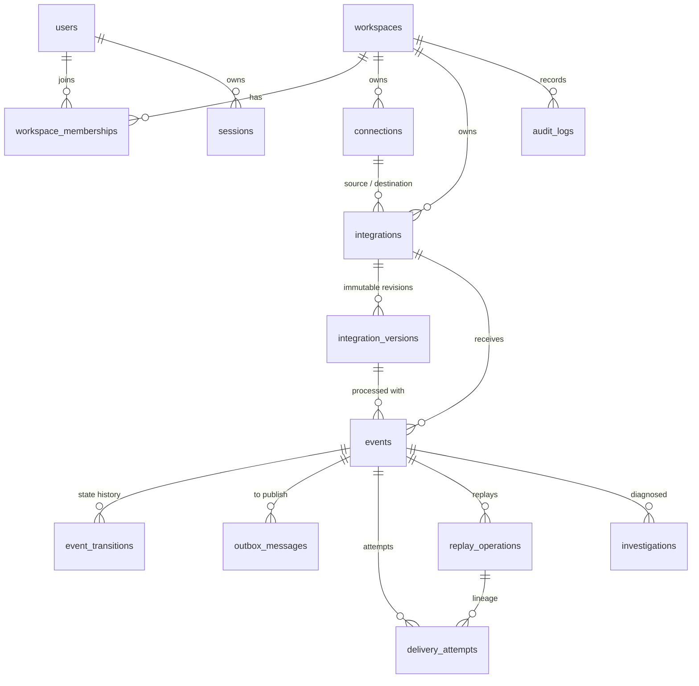

# Data model

PostgreSQL 16. Schema is defined in `relay_core/db/models.py` and created **only** by Alembic
migrations (`relay_core/db/migrations/`); tests build their database by running the migrations, and
CI fails if models and migrations drift (`alembic check`).

## Tables

| Table | Purpose | Notable constraints |
|---|---|---|
| `users` | Accounts. `password_hash` is Argon2id. | `email` unique and lower-cased (check constraint). |
| `workspaces` | Tenant boundary. `is_demo` labels demo data in the UI. | `slug` unique. |
| `workspace_memberships` | A user's role in a workspace. | Unique `(workspace_id, user_id)`; `role` check. |
| `sessions` | Server-side sessions. Stores a SHA-256 of the cookie token, never the token. | `token_hash` unique. |
| `connections` | A source or destination endpoint: adapter type, **safe** config, and a secret *reference*. | Unique `(workspace_id, name)`. No secret values, ever. |
| `integrations` | Routes one source connection to one destination; holds status and a pointer to the current version. | Unique `(workspace_id, name)`; `status` check. |
| `integration_versions` | Immutable configuration revisions (mappings, schemas, filters, retry). Rows are inserted, never updated. | Unique `(integration_id, version)`. |
| `events` | One accepted event for one integration: payloads, status, counters, failure summary. | **Unique `(integration_id, dedup_key)`** — the deduplication boundary. `status` check. |
| `event_transitions` | Append-only state history. | Identity primary key gives a total order. |
| `outbox_messages` | Transactional outbox: one row per delivery attempt that must reach the broker. | **Unique `(event_id, cycle, attempt_number)`** — scheduling an attempt is idempotent. |
| `delivery_attempts` | One row per attempt: outcome, HTTP status, timing, redacted response summary. | **Unique `(event_id, cycle, attempt_number)`** — a redelivered message cannot create a second attempt. |
| `replay_operations` | Replay lineage: who, why, which version, which cycle. | **Unique `(workspace_id, idempotency_key)`**. |
| `investigations` | Diagnosis reports with mode, provider, timing, token counts and human decisions. | `status`, `mode` checks. |
| `audit_logs` | Append-only record of configuration, membership and recovery actions. | — |
| `rate_limit_counters` | Fixed-window counters shared by all instances. | Primary key `(scope_key, window_start)`. |
| `local_queue_messages` | The development queue. Unused in the cloud profile. | — |
| `demo_destination_settings`, `demo_destination_requests` | State of the built-in demo destination. | Unique `(workspace_id, idempotency_key)`. |

Every tenant-owned table carries `workspace_id` with a foreign key, and every query in the
application layer filters on it.

## Why events are one row per integration

A source connection may feed several integrations. Ingestion inserts one event row per matching
integration, in one transaction. Each has its own status, attempts and deduplication key, so one
integration failing never blocks or confuses another.

## Deduplication key

`dedup_key` is `"i:" + sha256("id\0" + source_event_id)` when the source supplies an event id, else
`"b:" + sha256("body\0" + raw_body)`. Hashing keeps the key a fixed size regardless of what the
sender puts in an id. Identity wins over content: a repeat of the same id with a different body is
still a duplicate.

## Cycles and attempts

`events.delivery_cycle` starts at 1 and is incremented by each replay. `events.attempt_count` is
the number of attempts started in the current cycle. Attempts are identified by
`(event_id, cycle, attempt_number)`, which is why history survives a replay without renumbering.

## Indexes and the queries they serve

| Index | Serves |
|---|---|
| `events (workspace_id, received_at DESC, id DESC)` | Event explorer default order; keyset pagination. |
| `events (workspace_id, status, received_at DESC, id DESC)` | Explorer filtered by status; failures view; dashboard counts. |
| `events (workspace_id, integration_id, received_at DESC, id DESC)` | Explorer filtered by integration; integration health. |
| `events (workspace_id, source_event_id)`, `events (correlation_id)` | Exact-match lookup from the search box. |
| `events (processing_lease_expires_at) WHERE status='PROCESSING'` | Lease reaper. Partial: only rows mid-delivery. |
| `events (integration_id) WHERE status='HELD'` | Releasing held events on resume. |
| `outbox_messages (available_at, id) WHERE status='pending'` | Dispatcher claim. Partial: stays small however much history exists. |
| `event_transitions (event_id, id)` | Timeline for one event. |
| `delivery_attempts (workspace_id, started_at DESC)` | Dashboard latency percentiles. |
| `integrations (source_connection_id, status)` | Webhook routing. |
| `audit_logs (workspace_id, created_at DESC, id DESC)`, `(workspace_id, entity_type, entity_id)` | Audit list and per-entity history. |
| `investigations (workspace_id, created_at DESC, id DESC)` | Investigation list. |

Lists are **keyset-paginated** on `(timestamp, id)` using a row-value comparison that matches the
index order. Page cost is independent of depth and rows are neither skipped nor repeated when new
events arrive — see [algorithms.md](algorithms.md).

## Payload storage, redaction and retention

- **Stored raw.** `events.payload` holds the original JSON because delivery and replay need it.
  `transformed_payload` holds what was (or would be) sent.
- **Displayed redacted.** There is no API that returns a raw payload. Every read path applies
  `domain/redaction.py`: values under well-known sensitive keys (`password`, `token`,
  `authorization`, `card_number`, `secret`, …) and credential-shaped strings (bearer tokens, URL
  credentials, card numbers that pass a Luhn check) are replaced with `[REDACTED]`. An integration
  can add its own key names with `redact_fields`.
- **Never logged.** Logs carry identifiers and classifications only.
- **Response summaries** from destinations are redacted and truncated *before* they are stored,
  since they are never needed in raw form.
- **Retention.** `RELAY_PAYLOAD_RETENTION_DAYS` (default 30; 0 disables) removes the payload bodies
  of finished events in bounded batches. The event, attempts and history remain; the event can no
  longer be replayed. Published outbox rows and expired sessions are trimmed after 7 days.

Redaction is defence in depth, not a guarantee: it recognises known key names and value shapes.
Relay is not designed to store regulated data (card numbers, health records) and should not be
pointed at sources that send it.

## Migrations

One linear history. Each migration has a working `downgrade`. The integration↔version foreign key
is circular, so it is added with an explicit `ALTER TABLE` after both tables exist. Deploys apply
migrations before rolling new code and are expected to be backward compatible with the running
revision (expand first, contract in a later release), so rolling the code back never requires
rolling the schema back.
