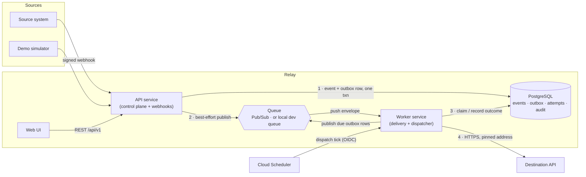

# Architecture overview

Relay is a **modular monolith with two deployable entry points**. One codebase and one database
schema; an API process and a worker process that scale and fail independently. It is deliberately
not a set of microservices: the domain is small, and a shared, well-bounded core is easier to keep
correct than a network of services.

## Components

| Component | Location | Responsibility |
|---|---|---|
| **Web UI** | `apps/web` | React + TypeScript console. Talks only to `/api/v1`. |
| **API service** | `services/api` | Authentication, RBAC, configuration CRUD, event queries, webhook ingestion, the demo destination. Never delivers events. |
| **Worker service** | `services/worker` | Receives broker push messages, runs delivery attempts, runs the outbox dispatcher and lease recovery. Not reachable from the internet. |
| **Core** | `packages/relay_core` | Everything both services share. See layers below. |
| **Queue** | Pub/Sub / local | Carries "run attempt N for event E" instructions. Identifiers only — never payloads. |
| **PostgreSQL** | Neon / local | The system of record. |

### Layers inside `relay_core`

Dependencies point inward: `services → domain`, never the reverse.

| Layer | Modules | Rule |
|---|---|---|
| **Domain** | `domain/` — state machine, transformation DSL, retry policy, URL safety, signatures, redaction, pagination, roles | Pure functions. No I/O, no database, no clock. Exhaustively unit-tested. |
| **Persistence** | `db/` — models, session, migrations | Schema and transactions only. |
| **Adapters** | `adapters/`, `messaging/` | Implement protocols for the outside world (sources, destinations, brokers). |
| **Application services** | `services/` — ingestion, outbox, processing, replay, integrations, auth, queries… | Orchestrate domain + persistence. Own transaction boundaries. |
| **Investigation** | `ai/`, `mcp_server.py` | Read-only tools, provider adapters, bounded loop, deterministic fallback. |

## The life of an event

1. **Ingest (API).** Check content type and size, verify the HMAC signature, parse JSON, derive
   the deduplication key. In **one transaction**: insert the event (`ON CONFLICT DO NOTHING` on the
   dedup constraint), validate it against the input schema, and insert an outbox row. Then answer
   `202`.
2. **Publish.** The API tries to publish that outbox row immediately. If that fails, nothing is
   lost: the row stays `pending` and the dispatcher publishes it later.
3. **Deliver (worker).** The broker pushes the message. The worker claims the event under a row
   lock, runs the pipeline (validate → filter → map → validate), records an in-progress attempt with
   a lease, **commits**, calls the destination with no lock held, then records the outcome in a
   second transaction.
4. **Outcome.** Success → `DELIVERED`. Retryable failure with budget left → `RETRY_SCHEDULED` plus
   an outbox row due at `next_attempt_at`. Otherwise → `DEAD_LETTERED`.
5. **Recover.** An operator can investigate (read-only) and replay (audited), which opens a new
   delivery cycle.

The state machine, transaction boundaries and failure modes are specified in
[reliability.md](reliability.md).

## Entry points

| Process | Command | Public? |
|---|---|---|
| API | `uvicorn relay_api.main:app_factory --factory` | Yes |
| Worker | `uvicorn relay_worker.main:app_factory --factory` | No (internal ingress + OIDC) |
| Migrations | `relay-migrate upgrade` | CLI |
| MCP server | `relay-mcp` (stdio) | Local process only |

## Profiles

| | `local` | `test` | `cloud` |
|---|---|---|---|
| Queue | PostgreSQL-backed dev queue | in-memory publisher | Pub/Sub |
| Dispatcher trigger | loop inside the worker | called directly by tests | Cloud Scheduler |
| Internal auth | shared token | shared token | Google OIDC |
| Needs cloud credentials | no | no | yes |
| Needs a model | no | no | no |

`Settings` (in `relay_core/config.py`) validates the profile at start-up: for example, the cloud
profile refuses to start with insecure cookies, a wildcard CORS origin, or the development SSRF
overrides enabled.

## Observability

- **Correlation id.** Assigned at the edge (or accepted from `X-Correlation-Id` if well-formed),
  stored on the event, carried in the queue message, sent to the destination as
  `X-Relay-Correlation-Id`, and present on every log line for that event.
- **Logs.** One JSON object per line with `severity`, `message`, `correlation_id`, `event_id`,
  `workspace_id` and outcome fields. Payloads and secrets are never logged.
- **Health.** `/healthz` is liveness (no dependencies, so a database outage does not restart
  healthy instances). `/readyz` checks the database is reachable and the schema is at the expected
  migration.
- **Operational figures.** `GET /api/v1/dashboard/summary` computes counts, success rate, attempt
  latency percentiles, retry and dead-letter counts, and the age of the oldest in-flight event and
  oldest unpublished outbox message directly from stored rows. No metrics service is required.

## Decisions

Rationale for the main choices is recorded as ADRs in [decisions/](decisions/):
project shape, messaging and outbox semantics, the transformation DSL, the deployment target, and
the investigation boundaries.
