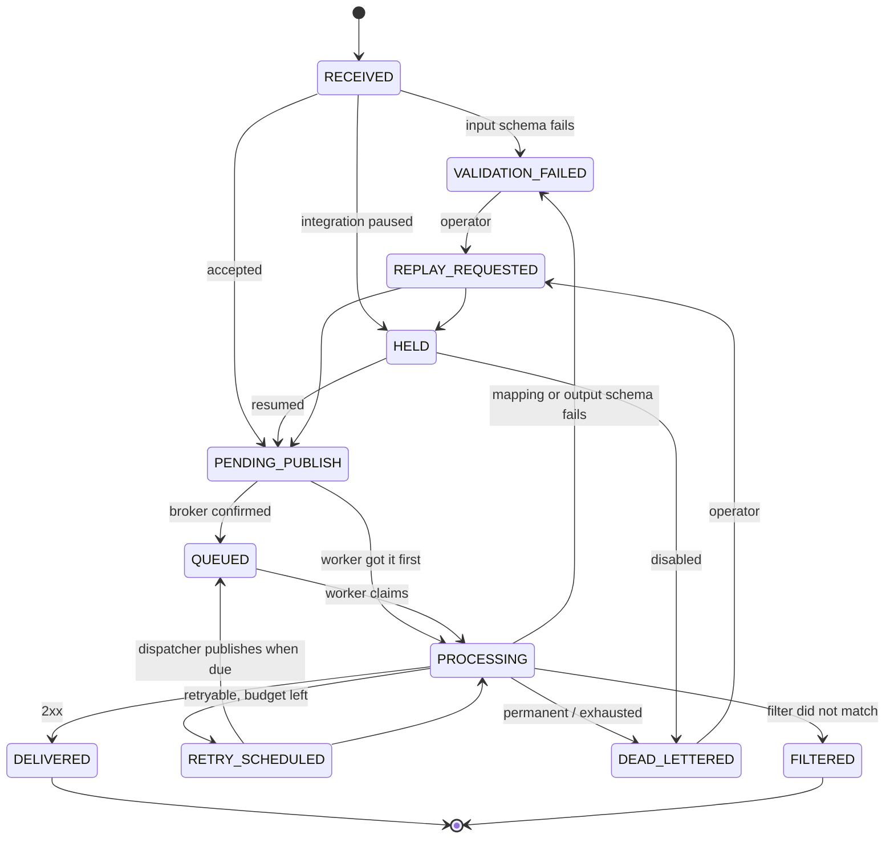

# Reliability

## The guarantee

**At-least-once delivery, with deduplication and idempotency protections.**

- An event that Relay acknowledged with `202` will be offered to the destination until it is
  accepted, permanently rejected, or its attempt budget is exhausted — across process crashes,
  broker redelivery and publish failures.
- The destination may see the same event **more than once**. Relay cannot prevent that in general
  (see "the ambiguous case"). It sends a stable idempotency key so a destination that honours it
  applies each event once.

Relay does **not** promise exactly-once side effects in external systems.

## State machine

The single definition lives in `relay_core/domain/states.py`. `services/event_state.transition()`
is the only function that changes `Event.status`; it checks the edge, writes the append-only
`event_transitions` row and updates derived timestamps, all in the caller's transaction. A static
test (`tests/unit/test_state_ownership.py`) fails the build if any other code assigns the status.



Not drawn, to keep the diagram readable: `PENDING_PUBLISH`, `QUEUED` and `RETRY_SCHEDULED` can
each move to `HELD` (integration paused) or `DEAD_LETTERED` (integration disabled, or the broker
gave up). The exhaustive edge list is asserted in `tests/unit/test_domain_rules.py`.

| State | Owner that moves an event out of it | Meaning |
|---|---|---|
| `RECEIVED` | ingestion | Stored; routed in the same transaction. |
| `PENDING_PUBLISH` | dispatcher (or worker) | An outbox row exists; the broker has not confirmed. |
| `QUEUED` | worker | Broker has the message. |
| `PROCESSING` | worker, or lease reaper | A worker holds a lease on an attempt. |
| `RETRY_SCHEDULED` | dispatcher | Waiting for `next_attempt_at`. |
| `HELD` | integration service | Integration paused; nothing is delivered. |
| `DELIVERED`, `FILTERED` | — | Final. |
| `VALIDATION_FAILED`, `DEAD_LETTERED` | replay service (operator) | Terminal unless replayed. |
| `REPLAY_REQUESTED` | replay service | Transient, within the replay transaction. |

`DELIVERED` is deliberately final. A delivered event cannot be replayed: the destination confirmed
it, and re-sending would be exactly the duplicate Relay exists to prevent.

## Transaction boundaries

| Step | In one transaction | Outside any transaction |
|---|---|---|
| Ingest | insert event · insert `RECEIVED` transition · route (`VALIDATION_FAILED` / `HELD` / `PENDING_PUBLISH` + outbox row) | signature check, JSON parse; the fast-path publish afterwards |
| Dispatch | **claim** (lease) → *publish* → **mark published** + `QUEUED` | the publish call |
| Claim attempt | lock event · discard duplicates · run pipeline · insert attempt (`in_progress`) · set lease · `PROCESSING` | — |
| Deliver | — | the HTTP call to the destination |
| Complete | lock event · record outcome · next state · outbox row for the retry | — |
| Replay | lock event · idempotency check · new cycle · transitions · outbox row · audit row | — |

No lock is ever held across a network call. Lock order is always **event row, then outbox row**.

## Durable hand-off: the transactional outbox

A database commit and a broker publish cannot be made atomic. Relay writes an `outbox_messages`
row in the same transaction as the event change, then a dispatcher publishes it:

```
claim:   SELECT … WHERE status='pending' AND available_at <= now AND lease expired
         ORDER BY available_at FOR UPDATE SKIP LOCKED      -- then set claim_token + lease
publish: broker.publish(message)                            -- must confirm before returning
mark:    UPDATE … SET status='published' WHERE id=? AND claim_token=?
```

| Failure | What happens |
|---|---|
| Publish fails | Claim released; `available_at` pushed back (2ⁿ s, capped at 60 s); `last_error` recorded. Retried indefinitely — the row is never dropped. Visible as "oldest unpublished queue message" on the dashboard. |
| Process dies after claiming | Lease expires (30 s); another dispatcher claims the row. |
| Process dies **after publishing, before marking** | Lease expires; the message is published again. The worker drops the duplicate (below). |
| Two dispatchers run at once | `SKIP LOCKED` gives each a disjoint set of rows. |

Retries use the same mechanism: scheduling attempt *N+1* is "insert an outbox row with
`available_at = next_attempt_at`". There is one scheduler, not two.

## Duplicate messages

A message carries `(event_id, cycle, attempt)`. The worker processes it only if the event is
claimable **and** `(cycle, attempt)` is exactly the event's next attempt. Anything else — a
redelivery of finished work, a republished outbox row, a stale replay cycle — is acknowledged and
dropped. A unique constraint on `delivery_attempts(event_id, cycle, attempt_number)` is the
backstop.

## Two kinds of retry, kept apart

| | Broker redelivery | Application retry |
|---|---|---|
| Covers | Worker/infra failure: crash, 5xx from the worker, timeout | Destination outcome: 5xx, 429, 408, timeout, transport error |
| Decided by | The worker's HTTP status to the broker | `domain/retry.py` |
| Schedule | Subscription backoff (10 s → 600 s) | Exponential backoff with full jitter, honours `Retry-After` up to the cap |
| Bound | 5 deliveries, then the dead-letter topic | `max_attempts` per integration (1–10) |

The worker returns **2xx for every outcome it has persisted**, including a destination failure — so
the broker does not also retry it. That is what prevents the two mechanisms multiplying into
`5 × max_attempts` deliveries. It returns non-2xx only for transient worker-side conditions.

Classification (`classify_http_status` and the HTTP adapter):

| Outcome | Disposition |
|---|---|
| 2xx | success |
| 408, 425, 429, 5xx, timeout, DNS/connect/reset, malformed HTTP response | retryable |
| 401, 403, 407 (auth); other 4xx; 3xx (redirects are never followed); URL blocked by SSRF policy; configuration/secret problems | permanent → dead-letter immediately |

Backoff: `delay = uniform(0, min(max_delay, base × 2^(attempt−1)))`, raised to the destination's
`Retry-After` when present but never above `max_delay`. Randomness is injectable, so tests are
deterministic.

## Worker crash mid-attempt

When the worker claims an attempt it sets `processing_lease_expires_at = now + timeout + 30 s`.

- **Broker redelivers while the lease is live** → the worker answers 503 ("in progress
  elsewhere"); no second delivery starts.
- **Lease expires** → either the redelivered message or the reaper (run on every dispatcher tick)
  closes the open attempt as `worker_interrupted` and applies the normal retry decision.
- **The original worker finishes late** → it finds its attempt already closed and discards its
  result.

An interrupted attempt counts toward `max_attempts`, so a worker that crashes on every attempt
cannot loop forever (`test_interrupted_attempts_count_toward_the_attempt_ceiling`).

## The ambiguous case

If a request times out, or the worker dies after sending but before recording, **Relay does not
know whether the destination acted**. It must retry (otherwise the event may be lost), so the
destination may receive it twice. Mitigations:

- every attempt and every replay of an event sends the same `Idempotency-Key` (the event id);
- the UI states the ambiguity on the timeout attempt and in the replay dialog;
- the demo destination's `slow_success` mode reproduces it: the order is stored, the response is
  lost, and the retry is recognised by its key instead of creating a second order
  (`test_lost_response_is_recovered_without_a_duplicate_order`).

A destination that ignores idempotency keys can be sent duplicates. That is a documented limit.

## Pause, resume, disable

- **Pause:** new events are stored as `HELD`; in-flight events become `HELD` when a worker next
  sees them. Nothing is dropped.
- **Resume:** every `HELD` event is re-queued in one transaction.
- **Disable:** held events are dead-lettered; the source stops matching the integration. They can be
  replayed after re-activation.

## Replay

Replay opens a new **delivery cycle** on the same event: `delivery_cycle += 1`, `attempt_count = 0`,
a fresh attempt budget. Old attempts keep their cycle number and are never renumbered or deleted.
A `replay_operations` row records who, why and under which configuration version; new attempts link
to it. The operation is idempotent on a client-supplied `Idempotency-Key`, and concurrent replays of
one event are serialised by the row lock, so exactly one wins.

## Known limits

- **Retry latency in the cloud** is bounded below by the dispatcher schedule (default every
  15 minutes — see the [cost model](../deployment/free-tier-cost-model.md)); locally it is one
  second. Traffic-driven dispatch narrows the gap while messages are flowing.
- **Resuming** an integration with a very large number of held events re-queues them in one
  transaction.
- **Ordering** between events is not guaranteed.
- **Payload retention** (default 30 days) removes stored bodies of finished events; a purged event
  cannot be replayed.
