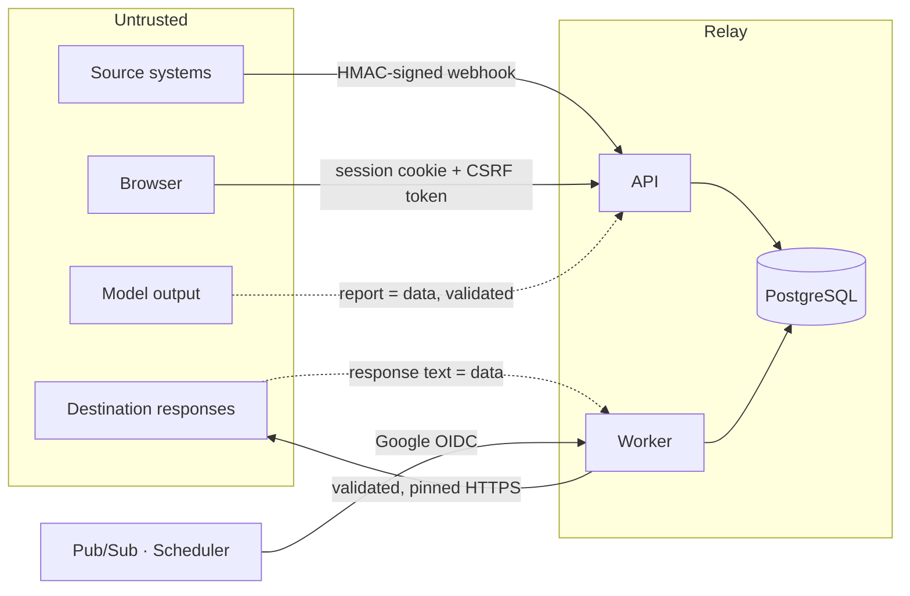

# Security

## Trust boundaries

Everything arriving across a boundary is treated as data to be validated, never as instructions:
webhook payloads, destination responses, and model output alike.

## Threat model

| Threat | Mitigation | Verified by |
|---|---|---|
| **Forged or replayed webhook** | HMAC-SHA256 over `"<timestamp>." + raw body`, constant-time comparison, ±5-minute tolerance. One generic 401 for every failure mode. A configured-but-missing secret fails closed (503). | `test_webhook_signature_is_enforced`, `test_signature_covers_the_exact_body`, `test_correctly_signed_but_stale_request_is_rejected` |
| **Oversized or malformed body** | Limit enforced on `Content-Length` *and* while streaming; strict JSON (no NaN, no NUL, depth-bounded); must be an object. | `test_oversized_body_is_rejected_by_declared_and_by_streamed_length`, `test_malformed_requests_are_rejected_without_persisting` |
| **Webhook flood** | Per-connection fixed-window limit in the database (holds across instances). Signed endpoints are counted *after* authentication so forged traffic cannot spend a real sender's allowance. Cloud Run `max_instances` caps total work. | `test_webhook_rate_limit_is_shared_state_and_counts_only_authentic_requests` |
| **Credential stuffing** | Argon2id; per-account and per-IP login limits; identical error and comparable timing for unknown users and wrong passwords. | `test_login_attempts_are_rate_limited_per_account`, `test_bad_credentials_give_one_indistinguishable_error` |
| **Session theft** | Opaque random token in an `HttpOnly` cookie (`Secure` enforced in the cloud profile); only its SHA-256 is stored; server-side expiry and revocation; changing a password revokes other sessions. | `test_login_sets_a_hardened_cookie…`, `test_logout_revokes_the_session_server_side` |
| **CSRF** | State-changing requests need the per-session `X-CSRF-Token` and an allowlisted `Origin`. CORS is an explicit allowlist; `*` is rejected at start-up. | `test_state_changing_requests_need_the_csrf_token`, `test_requests_from_unlisted_origins_are_refused` |
| **Privilege escalation** | Every route depends on `require(Permission.X)`; the role is read from the database on each request. | `test_viewer_cannot_perform_any_restricted_action`, `test_role_is_read_from_the_database_on_every_request` |
| **Cross-tenant access** | Every query filters on `workspace_id`; another workspace's ids return 404, indistinguishable from "does not exist". | `test_another_workspace_cannot_see_or_touch_anything` |
| **SSRF via destination URL** | See below. | `tests/security/test_edge_defences.py`, `tests/contract/test_contracts.py` |
| **Secret exfiltration via configuration** | The database stores references only; references are confined to the `RELAY_SECRET_*` namespace; credentials are rejected in URLs and static headers. | `test_secret_references_cannot_reach_outside_their_namespace` |
| **Sensitive data in logs / UI / model context** | Payloads are never logged; every read path redacts; response summaries are redacted before storage. | `test_event_detail_redacts_sensitive_fields_for_every_role`, `test_connection_secrets_never_reach_the_model` |
| **Prompt injection through payloads or responses** | See "Investigation assistant". | `test_a_model_that_tries_to_mutate_state_gets_nowhere` |
| **Internal endpoints reached from outside** | Worker has internal-only ingress and no public invoker; the application also verifies a Google OIDC token (audience, issuer, allowlisted service account). Local mode uses a shared token and refuses everything if none is set. | `test_worker_endpoints_require_internal_authentication`, `test_oidc_internal_auth_checks_audience_issuer_and_service_account` |
| **Error messages leaking internals** | One error envelope; unexpected errors return a generic message plus a correlation id; validation errors never echo input. | `test_errors_share_one_envelope_and_never_leak_internals`, `test_unexpected_errors_return_a_generic_500` |

## SSRF defences

A destination URL is operator-supplied, so the worker must not be steerable at internal services
(cloud metadata, loopback, private networks). Controls, in `domain/urlsafety.py` and
`adapters/http_destination.py`:

1. **At save time** — `https` only; no credentials, fragment or control characters in the URL;
   literal private/loopback/link-local/multicast/reserved addresses rejected; `localhost`,
   `*.local`, `*.internal` and unqualified hostnames rejected.
2. **At every attempt** — the hostname is resolved and **every** returned address must be publicly
   routable. One private record blocks the request; Relay never "picks the good one".
   IPv4-mapped, 6to4, NAT64 and Teredo forms are unwrapped before the check.
3. **Pinning** — the HTTP client connects to the validated address directly, with `Host` and TLS
   SNI set to the real hostname. There is no second DNS lookup for an attacker to answer
   differently (DNS rebinding). Verified against a live host: a correct certificate succeeds; a
   certificate for a different hostname is refused.
4. **No redirects** — a 3xx is a permanent failure, so a public host cannot bounce the request
   inward.
5. **No proxy environment** — `trust_env=False`, so proxy variables cannot route around pinning.
6. **Restricted request shape** — methods limited to POST/PUT/PATCH; hop-by-hop, `Host`,
   `Authorization`, `Cookie`, forwarding and `X-Relay-*` headers cannot be set; inbound request
   headers are never forwarded.
7. **Bounded response** — at most 64 KiB is read; a hard deadline applies to the whole exchange.

**Development override:** `RELAY_DESTINATION_ALLOW_PRIVATE_HOSTS` takes exact `host:port` entries.
It is empty by default and the cloud profile refuses to start if it is set. The built-in demo
destination's base URL is operator configuration, not user input, and is the one target allowed to
be private.

**Remaining limits.** Relay validates addresses, not ownership: a public address that fronts an
internal service (a misconfigured reverse proxy) is outside what it can detect. `getaddrinfo` has no
timeout of its own; a slow resolver is bounded by the platform request timeout. Egress filtering at
the network layer would be a further control and is not configured (it would need a VPC connector,
which has a standing cost).

## Authentication and authorisation

- **Passwords:** Argon2id via `argon2-cffi` with library defaults; 12–256 characters; rehashed on
  login if parameters change. No home-made cryptography anywhere.
- **Sessions:** 256-bit random token; `HttpOnly`; `SameSite=Lax`; `Secure` required in the cloud
  profile; 12-hour lifetime; revocable.
- **Same-origin deployment:** the UI host proxies `/api` to the API, so the cookie is first-party.
  That avoids `SameSite=None` and third-party-cookie breakage. CSRF protection is still enforced.
- **Roles:** Viewer ⊂ Operator ⊂ Administrator (`domain/roles.py`). The UI uses the permission list
  only to hide controls; the API is the control.

| | Viewer | Operator | Administrator |
|---|:-:|:-:|:-:|
| Read integrations, events, investigations, audit log | ✓ | ✓ | ✓ |
| Pause / resume, replay, investigate, record decisions, demo tools | | ✓ | ✓ |
| Connections, integration configuration, activate / disable, members | | | ✓ |

## Secrets

- Never in Git: `.env` is ignored; `.env.example` contains placeholders; `make setup` generates
  local values into a mode-600 file and does not print them.
- Never in the database: `connections.secret_ref` holds a name such as
  `env:RELAY_SECRET_ORDERS_WEBHOOK`. The pattern is anchored to `RELAY_SECRET_`, so a connection
  cannot reference `RELAY_DATABASE_URL` or any other variable.
- In the cloud, Cloud Run injects Secret Manager values as environment variables. Rotation is "add
  a secret version, deploy a new revision". Terraform creates secret containers only; values never
  enter Terraform state.
- CI authenticates to Google Cloud with GitHub OIDC and Workload Identity Federation. There is no
  service-account key file.

## Investigation assistant

The assistant is an attack surface because it reads attacker-influenced text (payloads, destination
responses). The design assumes a model **can** be talked into misbehaving and makes that harmless:

- **No capability to misuse.** The tool registry (`ai/tools.py`) contains seven read-only tools.
  There is no tool that writes, replays, fetches a URL, runs SQL or a shell, or reads a file. A
  request for any other tool name gets an error result.
- **The database enforces read-only.** Tools run in a `SET TRANSACTION READ ONLY` transaction, so
  even a defective tool handler could not write.
- **Scoped.** Tools are confined to one workspace and, during an investigation, to the single event
  under investigation.
- **Output is validated, not trusted.** The report must match a schema. Evidence references that no
  tool returned are stripped; a "fact" left with no evidence is demoted to an explicitly unverified
  note; a confident cause with no evidence is downgraded to low confidence; every recommendation is
  forced to `requires_approval`; proposed mappings are re-validated server-side.
- **Untrusted content is labelled.** Fields that carry external text are named `*_untrusted`, and
  the system prompt says to treat them as data.
- **Bounded.** Steps, tool calls per step, tool-result size, per-request time and total time are all
  capped.
- **Approval executes nothing.** Recording a decision on a recommendation writes an audit entry
  only. Replaying is a separate, permission-checked request by the operator.

The MCP server exposes the same registry over stdio for one workspace. It inherits the trust of
whoever can start the process and must not be exposed on a network.

## Supply chain

Lockfiles for Python (`uv.lock`) and Node (`package-lock.json`); CI installs from them only.
`pip-audit`, `npm audit`, a secret scan and SBOM generation run on every pull request. GitHub
Actions are pinned by commit SHA. Containers run as a non-root user with no build tools.

## Not in scope

Multi-factor authentication, SSO, self-service password reset, network-level egress filtering, a
WAF, and at-rest encryption beyond what the database provider supplies. These are listed so their
absence is a known decision rather than an oversight.
